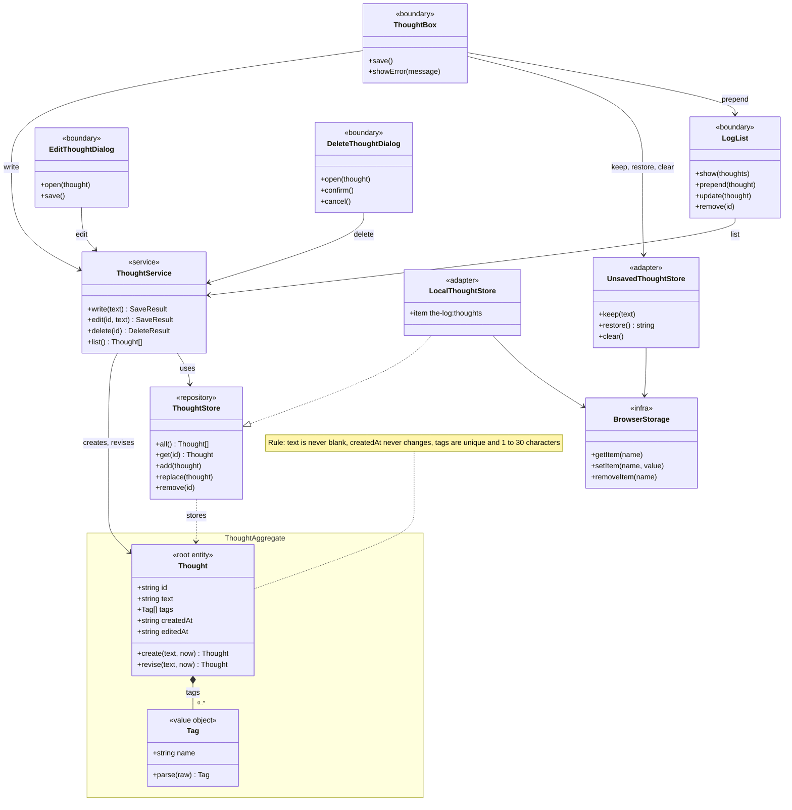
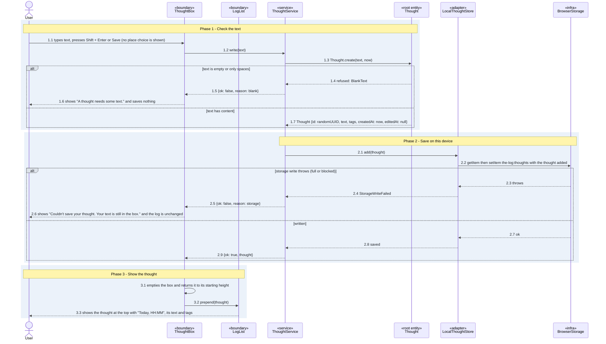
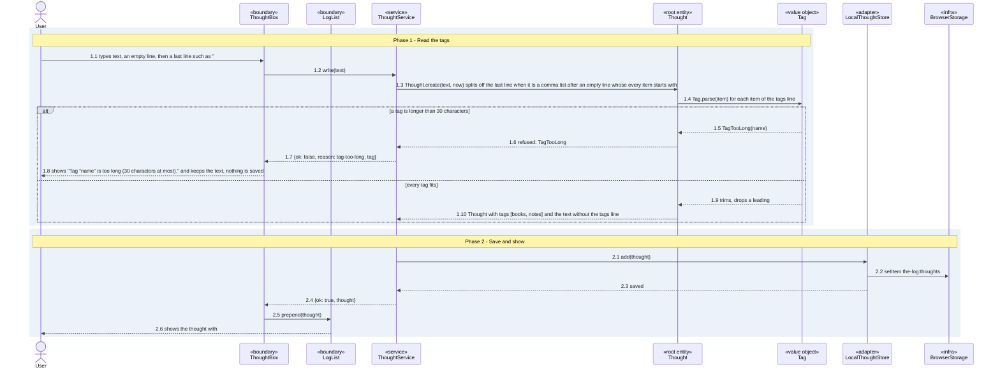
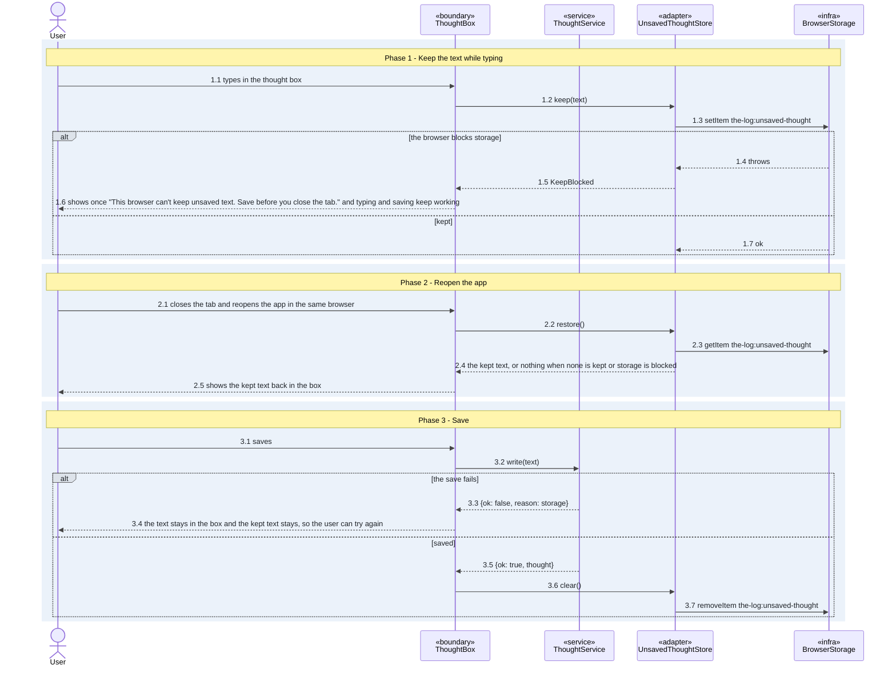
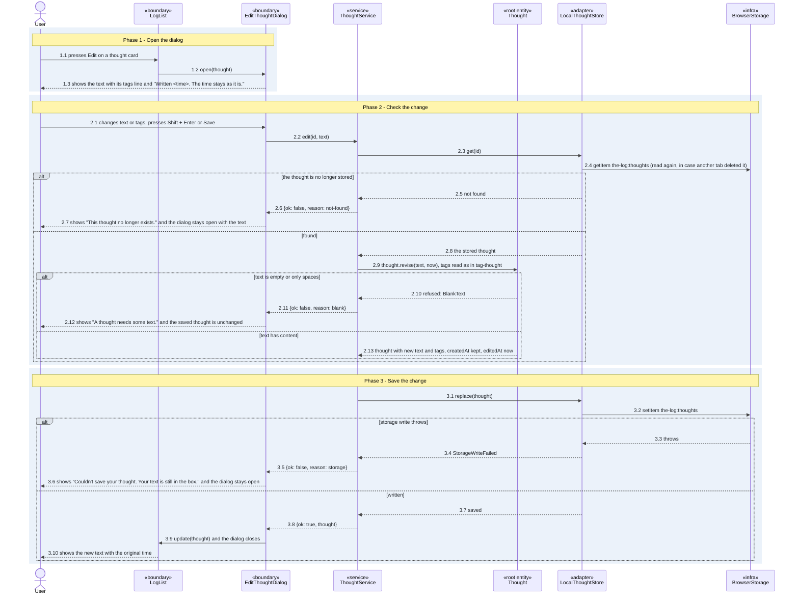
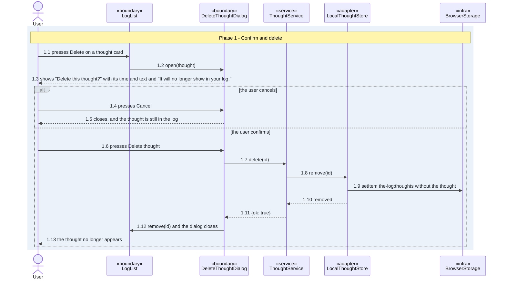
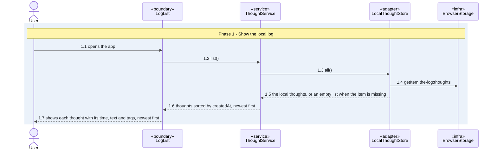

# UC-thought-capture - Thought Capture

| | |
|---|---|
| Slice | thought-capture |
| Scope | Feature: Thought Log > Thought Capture |
| Primary actor | User |
| Maturity | planned (greenfield) |

**Stories**

<!-- stories:start -->
- INIT-TL-0001 Write a thought
- INIT-TL-0002 Keep an unsaved thought
- INIT-TL-0003 Edit a thought
- INIT-TL-0004 Delete a thought
- INIT-TL-0005 Tag a thought
- INIT-TL-0009 Keep thoughts on this device
<!-- stories:end -->

## Description

The user writes a thought in free-form text, saves it with the current date and time and optional tags, and sees it at the top of the log. The user can edit or delete a saved thought. Half-written text survives a closed tab or a failed save. Every thought in this slice is a local thought: it is saved in this browser's storage on this device, and no place choice is offered. The UI follows the Home page of the design canvas "The Log Pages", with "thought" in place of the design's "entry".

## Preconditions

- The app is open in a browser at the GitHub Pages address.
- The user is not connected to GitHub (connecting is a later feature), so every thought is a local thought.

## Main flow

1. The user types text in the thought box, optionally ending with an empty line and a tags line such as `#books, #notes` (tag-thought 1.1). A thought with no tags line has no tags.
2. The user presses Shift + Enter or the Save button (write-thought 1.1).
3. The app checks the text and reads the tags, creates a thought with a unique id and the current date and time, and saves it in browser storage (write-thought 1.2 to 2.9).
4. The box empties and the thought shows at the top of the log (write-thought 3.1 to 3.3).
5. Later the user edits a thought in the edit dialog; the log shows the new text with the original time (edit-thought).
6. The user deletes a thought after confirming; it no longer shows (delete-thought).

## Alternative and exception flows

- Blank text: the user is told a thought needs some text and nothing is saved (write-thought 1.4 to 1.6, edit-thought 2.10 to 2.12).
- Browser storage cannot be written: the user is told the save failed and the text stays in the box (write-thought 2.3 to 2.6, edit-thought 3.3 to 3.6).
- A tag over 30 characters: the user is told it is too long and nothing is saved (tag-thought 1.5 to 1.8).
- An empty tag is dropped, and tags that differ only in letter case or surrounding spaces become one tag (tag-thought 1.9).
- The thought being edited was deleted in another tab of this browser: the user is told it no longer exists (edit-thought 2.5 to 2.7).
- The user cancels the delete confirmation: the thought stays (delete-thought 1.4 to 1.5).
- The browser blocks keeping unsaved text: the app still works and says once that unsaved text cannot be kept (keep-unsaved-thought 1.4 to 1.6).

## Postconditions

- A saved thought is in browser storage item `the-log:thoughts` with its id, text, tags, creation time and last edit time.
- After a successful save the unsaved text in item `the-log:unsaved-thought` is cleared.
- After a failed save the text is still in the box and in the unsaved text item.

## Acceptance criteria

| AC id | Story | Path | Flow | Given / when / then | Steps |
|---|---|---|---|---|---|
| AC-thought-capture-write-saved | Write a thought | main | write-thought | Given I have typed text, when I save, then a thought is added to the log with the current date and time and shows at the top | 1.1, 1.2, 1.3, 1.7, 2.1, 2.2, 2.7, 2.8, 2.9, 3.2, 3.3 |
| AC-thought-capture-write-box-empties | Write a thought | main | write-thought | Given I have saved a thought, when the save finishes, then the text box is empty and ready for the next thought | 2.9, 3.1 |
| AC-thought-capture-write-blank | Write a thought | failure | write-thought | Given the text box is empty or holds only spaces, when I save, then I am told a thought needs some text and nothing is saved | 1.4, 1.5, 1.6 |
| AC-thought-capture-write-save-fails | Write a thought | failure | write-thought | Given the save fails, when I save, then I am told it failed, my text stays in the box and nothing is added to the log | 2.3, 2.4, 2.5, 2.6 |
| AC-thought-capture-unsaved-reopen | Keep an unsaved thought | main | keep-unsaved-thought | Given I typed text and did not save, when I close and reopen the app in the same browser, then my text is back in the box | 1.1, 1.2, 1.3, 1.7, 2.1, 2.2, 2.3, 2.4, 2.5 |
| AC-thought-capture-unsaved-save-fails | Keep an unsaved thought | failure | keep-unsaved-thought | Given a save fails, when I look at the box, then my text is still there and I can try again | 3.1, 3.2, 3.3, 3.4 |
| AC-thought-capture-unsaved-cleared | Keep an unsaved thought | main | keep-unsaved-thought | Given a save succeeds, when it finishes, then the kept draft is cleared | 3.1, 3.2, 3.5, 3.6, 3.7 |
| AC-thought-capture-unsaved-blocked | Keep an unsaved thought | failure | keep-unsaved-thought | Given the browser blocks keeping drafts on this device, when I type, then the app still works and tells me drafts cannot be kept | 1.4, 1.5, 1.6 |
| AC-thought-capture-edit-saved | Edit a thought | main | edit-thought | Given a saved thought, when I change its text or tags and save, then the log shows the new text and keeps the original timestamp | 1.1, 1.2, 1.3, 2.1, 2.2, 2.3, 2.4, 2.8, 2.9, 2.13, 3.1, 3.2, 3.7, 3.8, 3.9, 3.10 |
| AC-thought-capture-edit-gone | Edit a thought | failure | edit-thought | Given the thought was deleted elsewhere, when I save, then I am told it no longer exists | 2.5, 2.6, 2.7 |
| AC-thought-capture-edit-save-fails | Edit a thought | failure | edit-thought | Given this device's browser storage cannot be written, when I save an edit, then my change is kept in the box and I see an error | 3.3, 3.4, 3.5, 3.6 |
| AC-thought-capture-edit-blank | Edit a thought | failure | edit-thought | Given I remove all the text, when I save, then I am told text is needed and the saved thought is unchanged | 2.10, 2.11, 2.12 |
| AC-thought-capture-delete-confirmed | Delete a thought | main | delete-thought | Given a thought, when I delete and confirm, then it no longer appears in the log | 1.1, 1.2, 1.3, 1.6, 1.7, 1.8, 1.9, 1.10, 1.11, 1.12, 1.13 |
| AC-thought-capture-delete-cancelled | Delete a thought | main | delete-thought | Given I cancel the confirmation, when I look at the log, then the thought is still there | 1.4, 1.5 |
| AC-thought-capture-tag-saved | Tag a thought | main | tag-thought | Given a thought being written or edited, when I add a tag and save, then the tag is saved with the thought | 1.1, 1.2, 1.3, 1.4, 1.9, 1.10, 2.1, 2.2, 2.3, 2.4, 2.5, 2.6 |
| AC-thought-capture-tag-same | Tag a thought | main | tag-thought | Given a tag that differs from an existing one only in letter case or surrounding spaces, when I add it, then it is treated as the same tag | 1.4, 1.9, 1.10 |
| AC-thought-capture-tag-too-long | Tag a thought | failure | tag-thought | Given a tag longer than 30 characters, when I add it, then I am told it is too long and it is not added | 1.5, 1.6, 1.7, 1.8 |
| AC-thought-capture-tag-empty | Tag a thought | main | tag-thought | Given an empty tag, when I add it, then it is not added | 1.4, 1.9 |
| AC-thought-capture-device-save | Keep thoughts on this device | main | write-thought | Given I am disconnected, when I save a thought, then it is saved as a local thought with no choice offered | 1.1, 2.1, 2.2, 2.7 |
| AC-thought-capture-device-log | Keep thoughts on this device | main | open-log | Given I am disconnected, when I open the log, then I see only local thoughts, newest first | 1.1, 1.2, 1.3, 1.4, 1.5, 1.6, 1.7 |
| AC-thought-capture-device-save-fails | Keep thoughts on this device | failure | write-thought | Given this device's browser storage cannot be written, when I save a thought, then I am told it failed and my text is kept | 2.3, 2.4, 2.5, 2.6 |

## Class diagram

## Sequence diagrams

### Sequence: write-thought

### Sequence: tag-thought

### Sequence: keep-unsaved-thought

### Sequence: edit-thought

### Sequence: delete-thought

### Sequence: open-log

## Design decisions

| D id | Decision | Alternatives | Why | Source | Steps |
|---|---|---|---|---|---|
| D1 | Project layout and stack: build the code in the existing React + TypeScript + Vitest app; new code goes under `src/thoughts/` and `src/AppShell.tsx` renders it | Describe only, with no code | The stories build the feature and the app shell already uses this stack | user-confirmed | write-thought 1.1 |
| D2 | Tags are typed on the last line of the text, after an empty line, as a comma-separated list in which every item starts with `#` (a tag may hold spaces: `#tag one`); that line is stored as tags and not as text. A line with any item lacking `#`, or with `# ` (a markdown heading), stays text, so a thought may have no tags | A separate tag field with chips | It matches the Home design | user-confirmed | tag-thought 1.3, 1.4 |
| D3 | Thought text is shown as plain text with its line breaks; Markdown is not rendered | Render Markdown as in the design | No story asks for Markdown and it would need a library | user-confirmed | write-thought 3.3, open-log 1.7 |
| D4 | Thoughts are stored in one browser storage item `the-log:thoughts` holding `{version: 1, thoughts: [{id, text, tags, createdAt, editedAt}]}`; the id comes from `crypto.randomUUID()`; times are ISO 8601 in UTC | One item per thought | One item is read and written whole, the same shape a gist file will have later | user-confirmed | write-thought 2.2, open-log 1.4 |
| D5 | A failed storage write gets one response: "Couldn't save your thought. Your text is still in the box.", the text stays and the log is unchanged; the same branch serves Write a thought and Keep thoughts on this device | A message per story | Both describe the same local write failure | user-confirmed | write-thought 2.6, edit-thought 3.6 |
| D6 | "Deleted elsewhere" means deleted in another tab of the same browser; the store is read again before an edit is written; the message is "This thought no longer exists." and the dialog stays open with the text | Check only the copy in memory | Without a connection, another tab is the only other place that can delete it | user-confirmed | edit-thought 2.3, 2.4, 2.7 |
| D7 | Shift + Enter or the Save button saves, in the box and in the edit dialog; blank text shows "A thought needs some text." | Save button only | It matches the Home design | user-confirmed | write-thought 1.1, 1.6, edit-thought 2.1, 2.12 |
| D8 | Unsaved text is kept for the new-thought box only, in item `the-log:unsaved-thought`, on every input; when storage is blocked the box shows once "This browser can't keep unsaved text. Save before you close the tab." | Keep the edit dialog's text too | The story is about the half-written new thought | user-confirmed | keep-unsaved-thought 1.3, 1.6 |
| D9 | Times show as in the design: "Today, 09:41", "Yesterday, 21:15", otherwise "Sun 15 Nov, 22:10", in the browser's local time | Full date and time | It matches the Home design | user-confirmed | write-thought 3.3, open-log 1.7 |
| D10 | A tag is trimmed, loses a leading #, and is lowercased; empty items are dropped; duplicates merge; a tag over 30 characters blocks the save with "Tag “name” is too long (30 characters at most)." and the text stays (a name over 30 characters is shown cut to its first 30 and "…") | Save the thought without the long tag | The user sees and fixes the tag before anything is saved | user-confirmed | tag-thought 1.8, 1.9 |
| D11 | Thought text and tags are rendered as text, never as HTML, and nothing leaves the device | None | Text typed by the user must not run as markup | user-confirmed | write-thought 3.3, open-log 1.7 |
| D12 | Rule of the Thought aggregate: text is never blank, createdAt never changes, tags are unique and 1 to 30 characters | None | It holds every story's rule in one place | user-confirmed | write-thought 1.3, edit-thought 2.9 |

## Interface contracts

| Flow | Method and path or message | Request | Success response | Steps |
|---|---|---|---|---|
| write-thought | `ThoughtService.write(text)` | the box text, tags on its last line | `{ok: true, thought}`, failures `{ok: false, reason: blank or storage or tag-too-long}` | 1.2, 1.5, 2.5, 2.9 |
| tag-thought | `Tag.parse(raw)` inside `Thought.create` and `Thought.revise` | one item of the tags line | a Tag, or `TagTooLong`, or nothing for an empty item | 1.4, 1.5, 1.9 |
| keep-unsaved-thought | `UnsavedThoughtStore.keep(text)`, `restore()`, `clear()` | the box text | kept text on restore; `KeepBlocked` when storage is blocked | 1.2, 1.5, 2.2, 3.6 |
| edit-thought | `ThoughtService.edit(id, text)` | the thought id and the dialog text | `{ok: true, thought}`, failures `{ok: false, reason: not-found or blank or storage}` | 2.2, 2.6, 2.11, 3.5, 3.8 |
| delete-thought | `ThoughtService.delete(id)` | the thought id, after confirmation | `{ok: true}` | 1.7, 1.11 |
| open-log | `ThoughtService.list()` | none | local thoughts, newest first | 1.2, 1.6 |

## Failure responses

| Failure | Trigger | Client response | AC id | Step |
|---|---|---|---|---|
| Blank text on write | the box is empty or holds only spaces | "A thought needs some text.", nothing saved, box unchanged | AC-thought-capture-write-blank | write-thought 1.6 |
| Storage write fails on write | browser storage throws on setItem | "Couldn't save your thought. Your text is still in the box.", log unchanged | AC-thought-capture-write-save-fails | write-thought 2.6 |
| Storage write fails on write, device story | the same failure, shared branch (D5) | the same response | AC-thought-capture-device-save-fails | write-thought 2.6 |
| Tag too long | a tags line item is over 30 characters | "Tag “name” is too long (30 characters at most).", text stays, nothing saved | AC-thought-capture-tag-too-long | tag-thought 1.8 |
| Unsaved text cannot be kept | browser storage throws when keeping the text | shown once: "This browser can't keep unsaved text. Save before you close the tab." | AC-thought-capture-unsaved-blocked | keep-unsaved-thought 1.6 |
| Save fails while text is kept | the write fails after typing | text stays in the box and in the kept item | AC-thought-capture-unsaved-save-fails | keep-unsaved-thought 3.4 |
| Edited thought is gone | another tab deleted the thought | "This thought no longer exists.", dialog stays open | AC-thought-capture-edit-gone | edit-thought 2.7 |
| Blank text on edit | the dialog text is empty or only spaces | "A thought needs some text.", saved thought unchanged | AC-thought-capture-edit-blank | edit-thought 2.12 |
| Storage write fails on edit | browser storage throws on setItem | "Couldn't save your thought. Your text is still in the box.", dialog stays open | AC-thought-capture-edit-save-fails | edit-thought 3.6 |

## Non-functional and security rules

| Rule | Source | Steps |
|---|---|---|
| Thought text and tags are rendered as text, never as HTML | D11 | write-thought 3.3, open-log 1.7 |
| Nothing leaves the device: this slice makes no network request | D11 | write-thought 2.2 |
| Times are stored in UTC and shown in the browser's local time | D4, D9 | write-thought 1.7, 3.3 |

## Open questions

| Item | Blocking |
|---|---|
| Delete a thought has no criterion for a failed storage write; what the user sees then is not decided | no |
| Keep thoughts on this device has no criterion for storage that cannot be read when the log opens (blocked, or damaged data) | no |
| Write a thought's Notes mention a size-limit warning, with no limit given and not tested here | no |

## Changes to existing specs

| Change | Wiki page | What changes | Reason |
|---|---|---|---|
| modified | hosting/design.md | The decision that the app page is a minimal React shell with the title "The Log" and a short placeholder line, and step 2.4 that shows the placeholder, change: the page shows the thought box and the log of local thoughts | Write a thought and Keep thoughts on this device fill the shell |
| modified | hosting/overview.md | The line "It shows a minimal app shell with the title "The Log" until later features fill it in" changes to say the page shows the thought box and the log | Write a thought and Keep thoughts on this device fill the shell |

## Implementation overview

Build plan, in order (layout from D1):

1. `src/thoughts/thought.ts`: the Thought and Tag types, `createThought`, `reviseThought`, `parseTag` and the tags-line split, with the rule of D12 and the tag rules of D10.
2. `src/thoughts/thoughtStore.ts`: the `ThoughtStore` interface. `src/thoughts/localThoughtStore.ts`: `LocalThoughtStore` over browser storage with the item shape of D4.
3. `src/thoughts/thoughtService.ts`: `ThoughtService` with `write`, `edit`, `delete` and `list`, returning the results of the interface contracts.
4. `src/thoughts/unsavedThoughtStore.ts`: `UnsavedThoughtStore` with `keep`, `restore` and `clear` (D8).
5. `src/thoughts/ThoughtBox.tsx`, `LogList.tsx`, `EditThoughtDialog.tsx`, `DeleteThoughtDialog.tsx`: the screen parts, styled after the Home page of the design canvas "The Log Pages", with "thought" in place of "entry".
6. `src/AppShell.tsx`: replace the placeholder line with the thought box and the log.
7. Tests next to each file (`*.test.ts`, `*.test.tsx`), run with `npm test`; browser storage is stubbed in tests.

## Traceability

| Step | What | Code |
|---|---|---|
| write-thought 1.3 | create a thought from the box text | `src/thoughts/thought.ts::createThought` planned |
| write-thought 1.2 | write a thought | `src/thoughts/thoughtService.ts::ThoughtService.write` planned |
| write-thought 2.2 | save in browser storage | `src/thoughts/localThoughtStore.ts::LocalThoughtStore.add` planned |
| write-thought 3.1 | empty the box after a save | `src/thoughts/ThoughtBox.tsx::ThoughtBox` planned |
| tag-thought 1.4 | parse one tag | `src/thoughts/thought.ts::parseTag` planned |
| keep-unsaved-thought 1.2 | keep the unsaved text | `src/thoughts/unsavedThoughtStore.ts::UnsavedThoughtStore.keep` planned |
| edit-thought 2.9 | revise a thought | `src/thoughts/thought.ts::reviseThought` planned |
| edit-thought 2.2 | edit a thought | `src/thoughts/thoughtService.ts::ThoughtService.edit` planned |
| edit-thought 1.3 | the edit dialog | `src/thoughts/EditThoughtDialog.tsx::EditThoughtDialog` planned |
| delete-thought 1.3 | the delete dialog | `src/thoughts/DeleteThoughtDialog.tsx::DeleteThoughtDialog` planned |
| delete-thought 1.8 | remove from browser storage | `src/thoughts/localThoughtStore.ts::LocalThoughtStore.remove` planned |
| open-log 1.6 | list thoughts newest first | `src/thoughts/thoughtService.ts::ThoughtService.list` planned |
| open-log 1.7 | show the log | `src/thoughts/LogList.tsx::LogList` planned |
| open-log 1.1 | render the box and the log | `src/AppShell.tsx::AppShell` planned |
