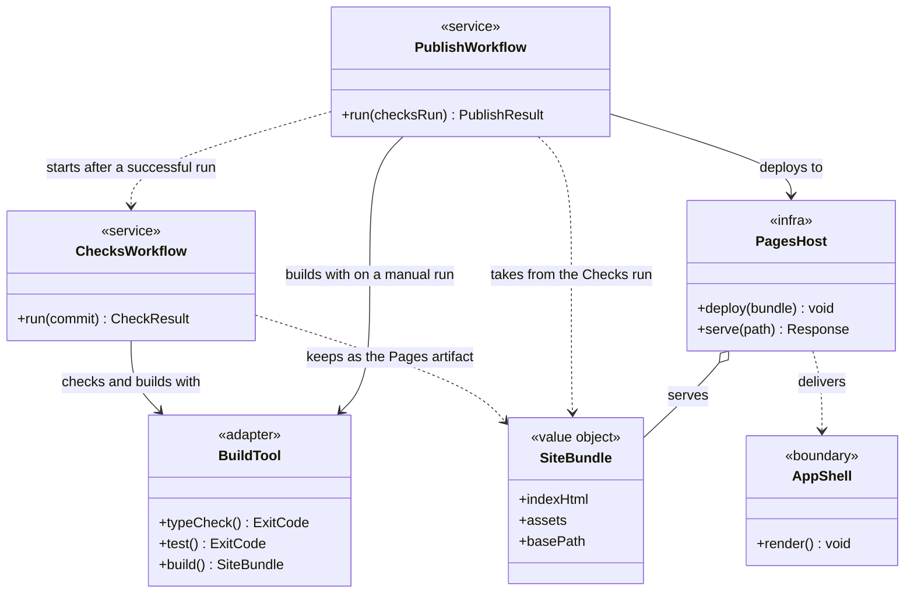
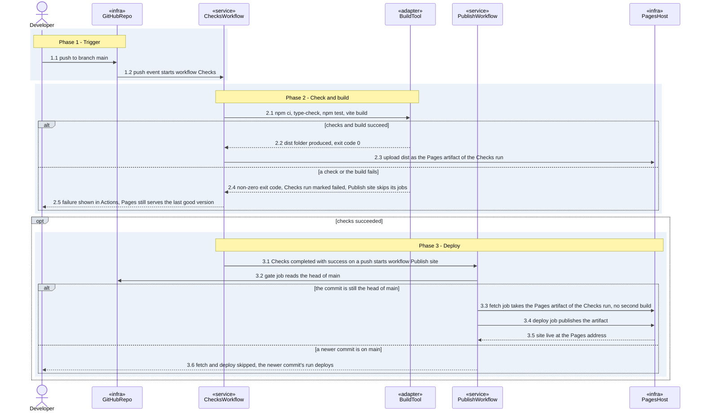
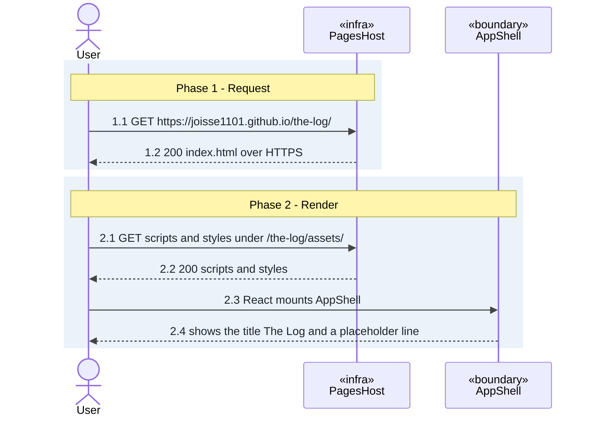

# Hosting: design

<!-- archive:init-the-log/hosting:start -->
## Open the log from GitHub Pages

Scope: Feature Hosting (Epic: Storage and Access).

### Behaviour

#### Open the log from GitHub Pages

| Situation | Result | AC id |
|---|---|---|
| A change on `main` is pushed | The site is rebuilt and published | AC-hosting-publish-on-push |
| I open https://joisse1101.github.io/the-log/ on a phone or a laptop | It is served over HTTPS and the app page is shown | AC-hosting-served-over-https |
| A type-check, test or build fails on a push to `main`, so Checks is marked failed and Publish site skips its jobs, and then I open the address | The live site is still the last good version | AC-hosting-last-good-site |
| I open the http:// address | It redirects to https://, because "Enforce HTTPS" is on | none |
| Publish site reaches its deploy job | The job runs only after fetch, or on a manual run build, has succeeded | none |
| The deploy job runs | It holds only contents read, pages write and id-token write | none |
| The fetch job runs | It holds only the permission to read Actions artifacts | none |
| Checks runs | It holds only read access to the contents | none |
| The site is built | No secret or access token is in the bundle | none |

### How it fits together

#### publish-site

#### open-site

### Decisions

| Decision | Why | Who chose |
|---|---|---|
| React and TypeScript, built with Vite and npm; the app lives at the repository root; the Vite base path is `/the-log/` | The base path matches the Pages address | user |
| A separate Publish site workflow deploys with the official Pages deploy, only after Checks succeeds for a push to `main`; the Pages source is "GitHub Actions" | A failed check or build never reaches the deploy job, so the last good site stays live | user |
| Type-check, tests and build run in their own Checks workflow, on pull requests and pushes to `main` | A failing change is caught before it is merged | user |
| On a push to `main`, Checks keeps the built `dist` as the Pages artifact, and Publish site deploys it without building again | `main` is built once, and the deployed files are exactly the ones the checks passed on | user |
| Publish site deploys only while the commit is still the head of `main`; a run for an older commit skips its jobs | A late run for an older commit cannot replace a newer deploy with stale content | user |
| A manual run of Publish site is allowed only on `main`, and it type-checks, tests and builds itself before deploying | A re-deploy needs no new commit and never publishes unchecked code | user |
| The app page is a minimal React shell with the title "The Log" and a short placeholder line | It shows that the site is live | user |
| Checks runs type-check (tsc), one Vitest test that the shell renders, and the Vite build | It gives the build a real gate | user |
| Both workflows use Node 26, the latest release | Use the latest | user |
| If the deploy job fails after a good build, the address keeps serving the last good version; no separate branch is drawn | No criterion covers it | user |
| No aggregate (no root entity of the domain) in this slice | The log's data belongs to later stories; Hosting only serves and publishes the app | user |
<!-- archive:init-the-log/hosting:end -->

## Sources

| Slice | Scope | Date | Review | Stories | Commit |
|---|---|---|---|---|---|
| init-the-log/hosting | Feature: Hosting (Epic: Storage and Access) | 2026-11-13 | review: run | Open the log from GitHub Pages (5bf6e7daaebb) | `6aaa5945d466538025938fbdd88ff9edfdeaecfc` |
