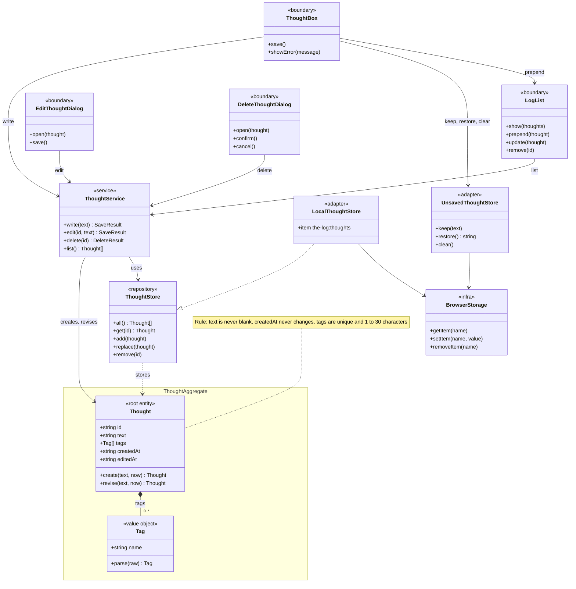
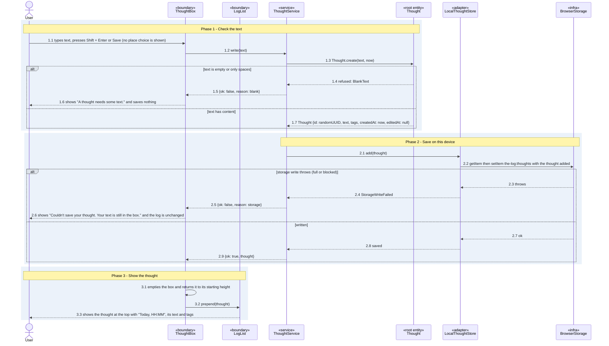
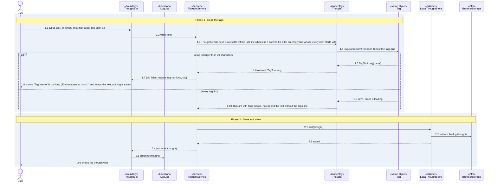
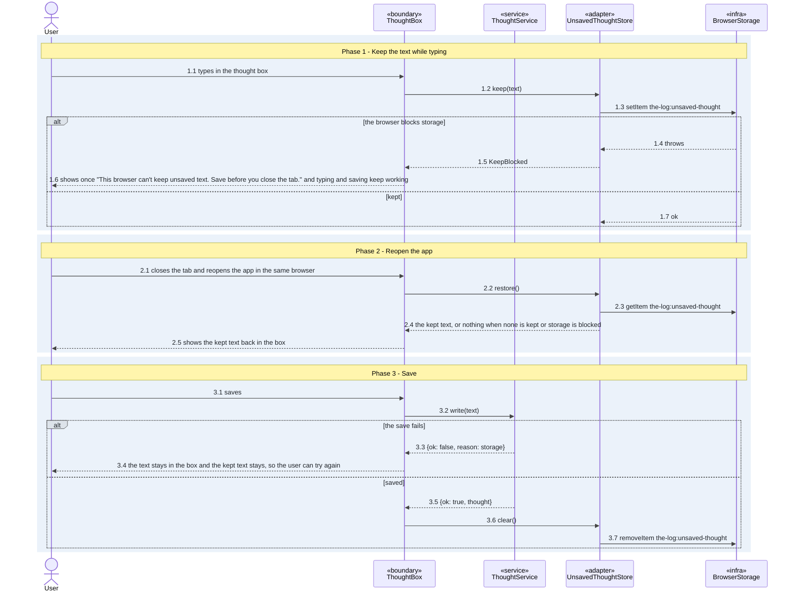
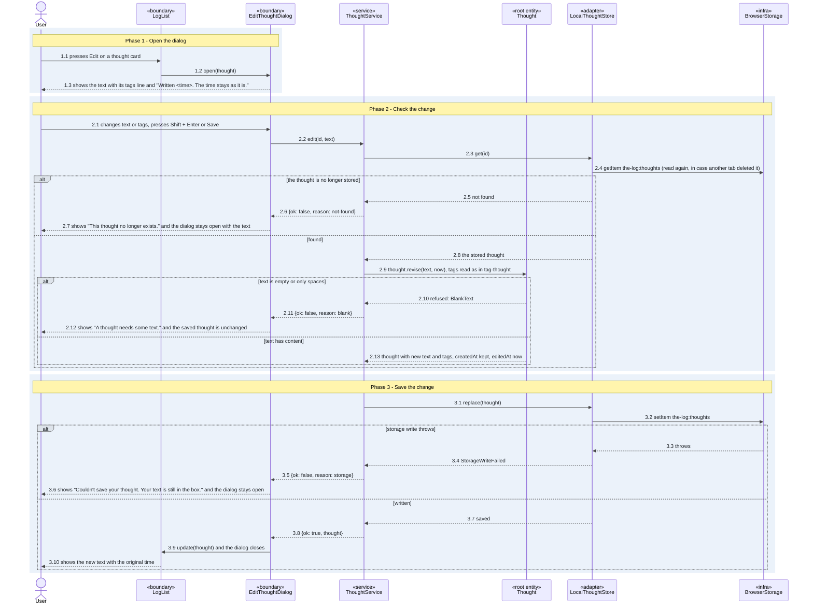
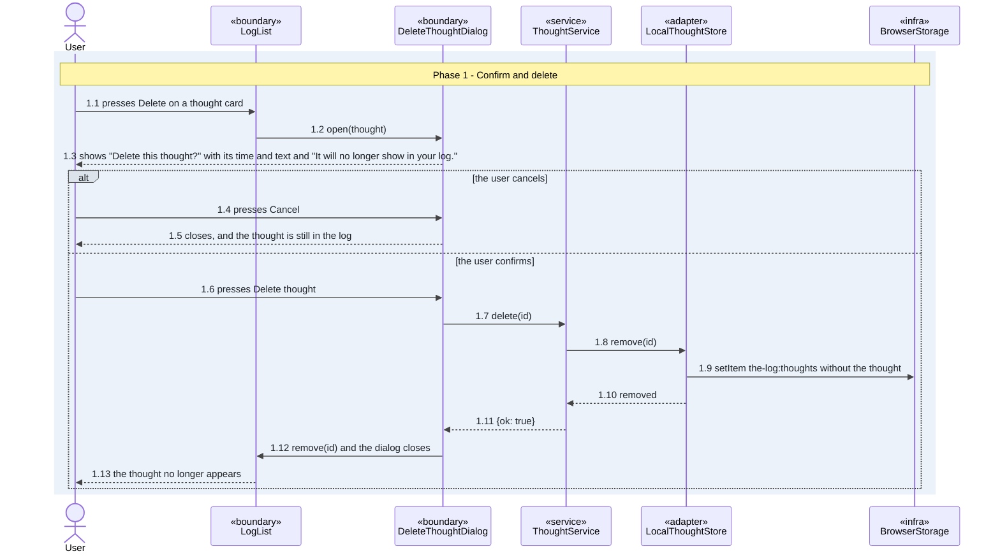
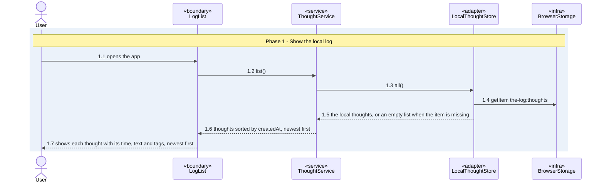

# Thought capture: timeline and markdown

How the home page lays out the text box and the log, and how a thought's text is shown. The design source is the Thought Capture page of the design canvas (artboards "Browse and write", "Typing interaction" for the growing box, "Markdown reference", "Home with entries" and "Home on a phone"; the last two are titled "Log home with entries" and "Log home on a phone" inside their files).

## The timeline

- The log is the timeline: its own scrolling area below the text box, apart from the page (`src/components/partials/Timeline.tsx`). It fills the rest of the screen. While the box is open it is never shorter than 240px (about two cards).
- Scrolling the timeline away from its top folds the text box (and the page header) into a one-line button, "Drag down to write a log". The box keeps its text while folded.
- The box opens again when the user presses that button, wheels up at the top of the timeline, or drags down at the top on a touch screen. Opening keeps the log the user was reading in view: the card that sat at the bottom of the view stays at the bottom while and after the box opens (`src/components/partials/keepInView.ts`). Only a scroll the user makes folds the box: a timeline scroll folds it only when a wheel turn, a touch drag, a press on the scroll bar or a scroll key (PageUp, PageDown, Home, End, Space, the up and down arrows) came just before it (within 400ms). A scroll the browser makes alone, because the timeline changed size or because focus moved into it (Tab), does not, however soon it comes after a Tab; tabbing through the whole log never folds the box, and a wheel turn right after a Tab still does. Opening the box by the button, the wheel or a drag always puts focus in the box.
- Saving is the only thing that moves the timeline for the user: it scrolls smoothly to the top, the box empties and folds, and focus goes to the hint button.
- The top edge fades out when the timeline is scrolled down, the bottom edge when more logs wait below (a 32px mask, set in `src/AppShell.css`).
- The scrollbar thumb of the timeline is 5px wide, 2px from the edge, round, 8px in from the top and bottom, in `--border-control` at 50% opacity. The thumb of the text box is 6px wide, 4px from the edge, round, 10px in from the ends, in `--border-control`. Firefox shows a thin bar in the same colours.
- A card's text is cut at seven lines, with a fade at the cut and a "Show more" / "Show less" button (`aria-expanded`, 44px tall, `src/components/CardText.tsx`). The button appears only when the text really is taller than seven lines. A paragraph or list is cut at exactly seven lines. A code block, table or quote that straddles the seven-line mark is left out whole (the text is cut at the block's top, with no fade); if that would leave fewer than three lines, the seven-line cut stays and its fade grows to one and a half lines (`src/components/cardCut.ts`).
- A date from an earlier year carries the year: "Thu 16 Oct 2025, 07:50". Today, Yesterday and this year's dates have none.
- With no thoughts the tagline says "Your thoughts will appear here." and the box asks "Write your first thought."; with thoughts the box asks "What happened today?".
- The hint button is 44px tall for touch size, a deliberate difference from the 36px of the artboard.
- A paragraph or quote stops at 65 characters a line (`max-width: 65ch`, as on the artboards), the most that reads comfortably. The page is a column just wide enough for a card whose text fills that line (`--column-max` in `src/AppShell.css`); a wider screen centres the column, with the header, the box and the timeline in it, instead of stretching the cards past their text.
- On a laptop each card has a dot and a line on its left (the first dot is pink). On a phone the rail is hidden and the cards are tighter.
- Not built yet, they belong to other slices: the tag filter chips, search, paging and the 100-entry cap, card titles, and the "Saved" toast.

## The text box and the page

- The box grows with its text, line by line, until it reaches its cap: the screen height less 96px (48px of room above and below). After that its text scrolls inside the box, with the styled bar. The height is set from the text by script (`src/components/partials/ThoughtBox.tsx`) so that it can be animated.
- The text is measured in an invisible copy of the box (a second textarea positioned inside the box, hidden and with no height), never in the real box, so measuring cannot change the page's height or move its scroll position.
- While the box is open the page itself scrolls when the content is taller than the screen: a big box pushes the header out of view (a header only partly in view fades out over `--motion-grow`, so no sliver of the tagline is left above a box at its cap; with reduced motion it hides at once), and the user scrolls the page down to reach any message under the box and the timeline. The timeline is never shorter than 240px (about two cards) there. Nothing is hidden or locked.
- Scrolling the page never folds the box. Only a scroll inside the timeline does.
- Folded, the page fits the screen and only the timeline scrolls.
- The page scrollbar looks like the timeline's. The page reserves room for its bar on both sides, so nothing moves when it appears.
- The page moves in step with the box. When the box's new height is known, the page's scroll position for that final height is worked out once, and the page scrolls to it along the same curve and over the same time as the height transition (`--motion-grow` and `--motion-ease`), so the box and the page move together. The scroll counts as starting at the start of the frame, as the browser dates the transition (`animationStart` in `src/components/motion.ts`); timing it from the moment the script ran left it up to a frame behind, and the box ran a few pixels past its margin. Below the cap the page scrolls just far enough to keep the box and a 12px margin above the bottom of the screen; nothing moves when the box already fits.
- When the box reaches its cap and has focus, that target is the one that puts the box in the middle of the screen (equal space above and below; the arithmetic is in `src/components/partials/centerBox.ts`). Only one scroll starts per cap entry: a later keystroke can extend the running scroll further down but never turn it back, and once the box is centred (or within 2px) nothing moves, so a new line never moves the page. If the user scrolls the page away and types again, the box is centred again.
- Deleting lines: when the box gets shorter, the page scrolls to its new end along the same curve and over `--motion-grow`, instead of the browser pulling it up at once. With reduced motion it is instant.
- On a wider screen the new-thought box has no Save button, as the Home artboards show: Shift + Enter saves, and the "Shift + ⏎ to save" hint says so. The edit dialog keeps its Save button at every width.
- On a phone (below 40rem) the Save button sits under the box and stays on screen: the box cap is 64px smaller (the 16px gap and the 48px button), and at the cap the box and the button are centred together. The "Shift + ⏎ to save" hint is hidden there and the box's bottom padding is 16px.
- The "Shift + ⏎ to save" hint has a surface-coloured pill behind it so text scrolling under it never collides with it. The pill is offset by its own padding (8px) so the words themselves sit where the artboard puts them: the hint text 32px from the right edge, the blank-text message in line with the box text.
- The blank-text message ("A thought needs some text.") shows inside the field at bottom left, over the text, so nothing below moves; it clears on typing and when the box loses focus. The storage-failure, tag and cannot-keep notices stay under the box.
- Ctrl+Home inside the capped box scrolls its text to 0 (`scroll-padding-block-start` of 32px).
- At the cap the text scrolls inside the box, and the browser keeps the caret clear of the "Shift + ⏎ to save" hint with `scroll-padding-block-end`. Focus is kept throughout.

## Motion

Every duration and the easing are custom properties at the top of `src/AppShell.css`. Change them there; a duration of `0ms` switches that motion off.

| Property | Default | What it times |
| --- | --- | --- |
| `--motion-fold` | `320ms` | The box folding into the hint and the hint opening back into the box (height and fade), with the header and the timeline following. |
| `--motion-grow` | `160ms` | The text box growing or shrinking as text is typed or deleted. |
| `--motion-scroll` | `400ms` | The timeline scrolling to the top after a save. The scroll uses an ease-out curve set in `src/components/motion.ts`. |
| `--motion-ease` | `cubic-bezier(0.4, 0, 0.2, 1)` | The curve of the fold and the growing box. |

- Under `prefers-reduced-motion: reduce` the three durations are `0ms`, so nothing animates.
- While the box opens, the card that sat at the bottom of the timeline is held in place frame by frame (`src/components/partials/keepInView.ts`), so the log being read does not jump.
- The timeline ignores scroll events for the length of the fold (plus 80ms) and for 150ms after any size change, because the browser may move `scrollTop` while the layout animates. Only a scroll the user makes outside those windows folds the box, and a scroll counts as the user's only when user input came just before it (see above).

## Markdown

- A thought's text is shown as markdown by `src/components/ThoughtMarkdown.tsx`: headers 1 to 6, paragraphs, bold, italic, struck text, links, inline code, quotes, bullet, numbered and task lists, fenced code, tables and dividers. The look follows the Markdown reference artboard.
- A line of only `#` marks (such as `#` or `###`) is a header with no words; it shows as those marks in a paragraph, never as an empty header, in the card and in the delete dialog.
- In a list that mixes plain items and tasks, the plain items keep their bullets; only a list made wholly of tasks has none.
- The last line of tags is split off before this (see `src/domain/thought.ts`) and shown as chips.
- Tags are typed on the last line, after an empty line, as a comma-separated list where every non-empty item starts with `#`: `#tag1, #tag2`. A tag may contain spaces (`#tag one`); inner runs of spaces collapse to one and the name is lowercased, so `#Tag  One` and `#tag one` are the same tag. Empty items are dropped and duplicates merge.
- If any non-empty item lacks a leading `#`, or the `#` is followed by a space (`# Heading`), or there is no `#` item at all, the line is not a tags line: it stays part of the text and the thought has no tags. A thought with no tags is normal.
- A name is at most 30 characters, counted without the `#`; a longer one fails with "Tag “name” is too long (30 characters at most)." and nothing is stored.
- The edit dialog shows the tags back as `#tag one, #tag two` on a last line after an empty line. A tag-less text whose own last line (after an empty line) is an all-`#` list gets an extra empty last line, so saving unchanged never changes text or tags.
- Raw HTML is never read as HTML: it shows as the characters typed. The text is turned into React elements from the parsed tokens, never into an HTML string.
- Only http:, https: and mailto: links become links, and they open in a new tab with `rel="noopener noreferrer"`. Any other link stays plain text. Bare web addresses are not linked.
- A markdown image shows its alt text. No image is requested, so showing a thought makes no network request.
- The edit dialog keeps a plain text box, and the delete dialog shows the plain text, cut to seven lines.

## Edit and delete dialogs

The edit dialog (`src/components/partials/EditThoughtDialog.tsx`) keeps a plain text box and the line "Markdown works. Put your tags on the last line, after an empty line, each starting with #, separated by commas." The dialog is a column that never scrolls: its text field takes whatever height the header, the error line, the tips line and the buttons leave, so they always stay on screen, with or without an error; a long thought scrolls inside the box (which keeps 240px where space allows), and a long unbreakable tag wraps instead of widening the dialog. The box has the same scrollbar as the new-thought box. A tap outside the edit dialog does not close it, so half-written edits are never lost by accident; Escape, the X button and Cancel close it. On a phone the sentence "The time stays as it is." and the "Shift + ⏎ to save" hint are hidden, and the box's bottom padding is 16px as in the new-thought box.

The delete dialog (`src/components/partials/DeleteThoughtDialog.tsx`) has two buttons that stay 48px tall on one line on a phone. It shows the thought as plain text built from the markdown-it tokens (`src/components/partials/plainText.ts`): text content only, never HTML. A header on the first line becomes a title line; the rest is cut to seven lines. A tap outside it closes it. When deleting fails, the line "It will no longer show in your log." is hidden while the failure message shows.

When a save finds the thought gone ("This thought no longer exists."), the card leaves the log as the dialog closes, and focus goes to the page heading, the same as after a delete.

While a dialog is open, the card's Edit or Delete button that opened it keeps a filled background (the `data-dialog-open` attribute, set by `useOpenerHighlight` in `src/components/dialogKeys.ts`). It needs the button to have focus when the dialog opens, which Safari does not give on a click, so there the fill is skipped.

Below 40rem the dialogs use `--space-5` padding, the X button is 44px, and the action buttons share the full row at 48px high.

<!-- archive:init-the-log/thought-capture:start -->
## Thought capture

Scope: Feature: Thought Log > Thought Capture.

### Behaviour

#### Write a thought

| Situation | Result | AC id |
|---|---|---|
| I have typed text and I save | A thought with the current date and time is added and shows at the top of the log | AC-thought-capture-write-saved |
| A save finishes | The text box is empty and ready for the next thought | AC-thought-capture-write-box-empties |
| The box is empty or holds only spaces and I save | "A thought needs some text." shows and nothing is saved | AC-thought-capture-write-blank |
| Browser storage throws when I save | "Couldn't save your thought. Your text is still in the box." shows and the log is unchanged | AC-thought-capture-write-save-fails |
| A thought is shown | Its text and tags render as text, never as HTML | none |

#### Keep an unsaved thought

| Situation | Result | AC id |
|---|---|---|
| I typed text, did not save, and close and reopen the app in the same browser | My text is back in the box | AC-thought-capture-unsaved-reopen |
| A save fails | The text stays in the box and in the kept item, so I can try again | AC-thought-capture-unsaved-save-fails |
| A save succeeds | The kept text is cleared | AC-thought-capture-unsaved-cleared |
| The browser blocks keeping text and I type | The app keeps working and shows once "This browser can't keep unsaved text. Save before you close the tab." | AC-thought-capture-unsaved-blocked |

#### Edit a thought

| Situation | Result | AC id |
|---|---|---|
| I change a saved thought's text or tags and save | The log shows the new text with the original time | AC-thought-capture-edit-saved |
| Another tab deleted the thought and I save | "This thought no longer exists." shows and the dialog stays open with the text | AC-thought-capture-edit-gone |
| Browser storage throws when I save an edit | "Couldn't save your thought. Your text is still in the box." shows and the dialog stays open | AC-thought-capture-edit-save-fails |
| I remove all the text and save | "A thought needs some text." shows and the saved thought is unchanged | AC-thought-capture-edit-blank |

#### Delete a thought

| Situation | Result | AC id |
|---|---|---|
| I press Delete thought in the confirmation | The thought no longer appears in the log | AC-thought-capture-delete-confirmed |
| I press Cancel in the confirmation | The thought is still in the log | AC-thought-capture-delete-cancelled |

#### Tag a thought

| Situation | Result | AC id |
|---|---|---|
| I end a thought being written or edited with an empty line and a tags line such as `#books, #notes`, and save | The tags are saved with the thought | AC-thought-capture-tag-saved |
| A tag differs from another only in letter case or spaces | It is stored as the same tag | AC-thought-capture-tag-same |
| A tag is longer than 30 characters and I save | "Tag “name” is too long (30 characters at most)." shows and nothing is saved | AC-thought-capture-tag-too-long |
| The tags line holds an empty item | The empty item is not added | AC-thought-capture-tag-empty |

#### Keep thoughts on this device

| Situation | Result | AC id |
|---|---|---|
| I am disconnected and save a thought | It is saved as a local thought, with no place choice offered | AC-thought-capture-device-save |
| I am disconnected and open the log | Only local thoughts show, newest first | AC-thought-capture-device-log |
| Browser storage cannot be written and I save | "Couldn't save your thought. Your text is still in the box." shows and the text is kept | AC-thought-capture-device-save-fails |
| A thought is saved, edited or deleted | No network request is made | none |
| A time is stored | It is stored in UTC and shown in the browser's local time | none |

### How it fits together

#### write-thought

#### tag-thought

#### keep-unsaved-thought

#### edit-thought

#### delete-thought

#### open-log

### Decisions

| Decision | Why | Who chose |
|---|---|---|
| Build in the existing React + TypeScript + Vitest app; new code goes in layer folders under `src/`: `domain/`, `service/`, `ports/`, `adapters/`, `components/` (shared pieces) and `components/partials/` (the parts of the page). `src/AppShell.tsx` renders it. The plan had one flat `src/thoughts/` folder; the layers replaced it before merge | The stories build the feature and the app shell already uses this stack; layer folders keep the domain apart from storage and the screen | user |
| Tags are typed on the last line, after an empty line, as a comma-separated list in which every item starts with `#`; a tag may hold spaces (`#tag one`). That line is stored as tags, not text. A line with an item lacking `#`, or with `# ` (a heading), stays text, so a thought may have no tags | It matches the Home design | user |
| A thought's text is shown as Markdown, turned into React elements from the parsed tokens and never into HTML. The plan had plain text; it changed when the Markdown reference artboard was put in scope | The Markdown artboard is part of this slice, and building elements from tokens keeps typed text from running as markup | user |
| Thoughts are stored in one browser storage item, `the-log:thoughts`, holding `{version: 1, thoughts: [...]}`; ids come from `crypto.randomUUID()`; times are ISO 8601 in UTC | One item is read and written whole, the same shape a gist file will have later | user |
| A failed storage write gets one response, "Couldn't save your thought. Your text is still in the box.": the text stays and the log is unchanged, for Write a thought and Keep thoughts on this device alike | Both stories describe the same local write failure | user |
| "Deleted elsewhere" means deleted in another tab of this browser, so the store is read again before an edit is written | Without a connection, another tab is the only other place that can delete it | user |
| Shift + Enter saves in the box and in the edit dialog; the new-thought box has a Save button on a phone only (below 40rem), and the edit dialog has one at every width | The desktop artboards show only the hint, and the phone artboard a full-width button | user |
| Unsaved text is kept for the new-thought box only, in `the-log:unsaved-thought`, on every input; blocked storage shows one notice | The story is about the half-written new thought | user |
| Times show as "Today, 09:41", "Yesterday, 21:15", otherwise "Sun 15 Nov, 22:10", in the browser's local time | It matches the Home design | user |
| A tag is trimmed, loses its `#` and is lowercased; empty items drop and duplicates merge; a tag over 30 characters blocks the save, and the message shows its first 30 characters and "…" | The user sees and fixes the tag before anything is saved | user |
| Text and tags are never rendered as HTML, and nothing leaves the device | Text the user types must not run as markup | user |
| The Thought aggregate's rule: text is never blank, createdAt never changes, tags are unique and 1 to 30 characters | It holds every story's rule in one place | user |

### Known limits

- Storage that cannot be read when the log opens (blocked, or damaged data) shows an empty log with no message, and every save then fails with the storage message; the stored item is left untouched.
- Nothing warns when the browser's storage is nearly full; the notes of Write a thought mention such a warning, with no limit given.
- Deleting a thought that another tab already removed succeeds without a message.
<!-- archive:init-the-log/thought-capture:end -->

## Sources

| Slice | Scope | Date | Review | Stories | Commit |
|---|---|---|---|---|---|
| init-the-log/thought-capture | Feature: Thought Log > Thought Capture | 2026-11-20 | review: run | Write a thought (46bffc5b15f2); Keep an unsaved thought (fa7b5244eae1); Edit a thought (da700c7f7b9f); Delete a thought (044f76ea3016); Tag a thought (2329030b35d3); Keep thoughts on this device (697e96fc26ba) | `4e98d4e52043e5fb286565516c9b5a1ac22bc513` |
